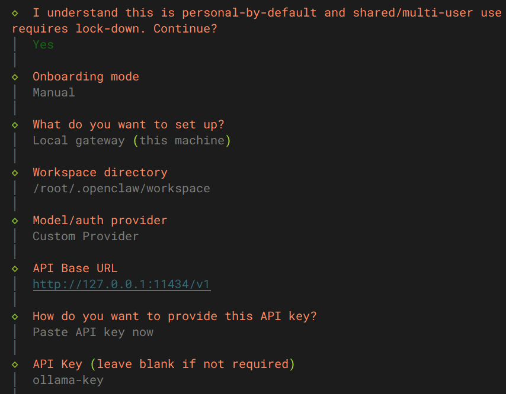
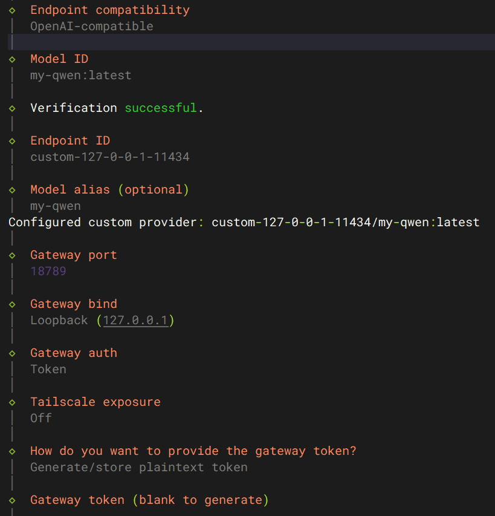
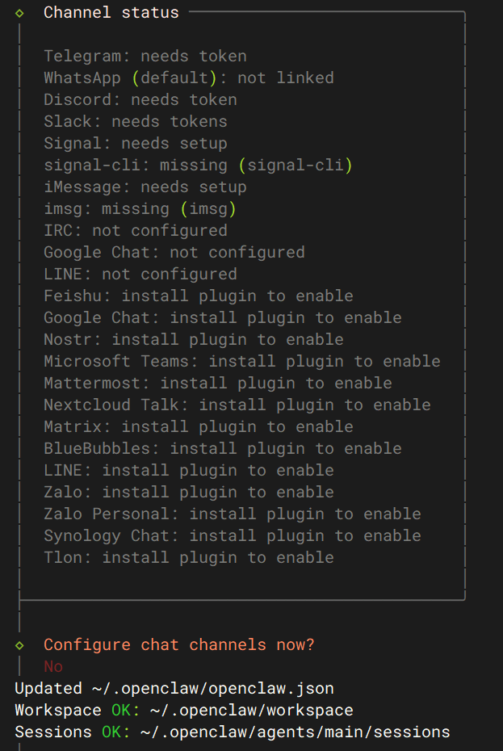
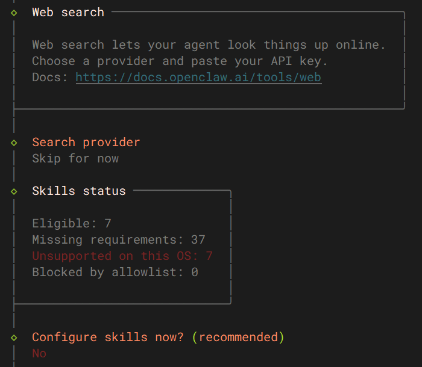

# 服务器部署OpenClaw

## 1. 安装openclaw

这里使用云服务器自带openclaw
也可以
```sh
    curl -fsSL https://openclaw.ai/install.sh | bash
    # 检查node.js
    node -v
    npm -v
```
从源代码安装
```sh
    git clone https://github.com/openclaw/openclaw.git
    cd openclaw
    npm install # 安装依赖
    npm run build # 构建项目
    npm link # 链接项目,使得命令全局可用
    openclaw --version
```


## 2. 配置openclaw
```sh
    # install-daemon 表示安装 OpenClaw 为系统后台服务
    # 初始化配置，同时自动把 OpenClaw 安装为系统后台服务
    openclaw onboard --install-daemon
    # --- 1.选择模型
    ollama list #确认Ollama正常、Qwen已拉取
    #验证Ollama服务通不通
    curl http://127.0.0.1:11434
    # 返回 Ollama is running 即正常
    # Qwen 选项 = 对接阿里通义千问云端官网，强制网页 OAuth 授权流程
    # 你本地 Ollama 跑模型不需要账号、不需要密钥、不需要网页授权，选 Qwen 必然授权失败  
```
配置文件参考





说明：
1. 使用ollama部署的Qwen模型,所以模型处选择Custom Provider [ollama部署的Qwen]
2. API Base URL 为 http://127.0.0.1:11434/v1
3. API Key 为 ollama-key
